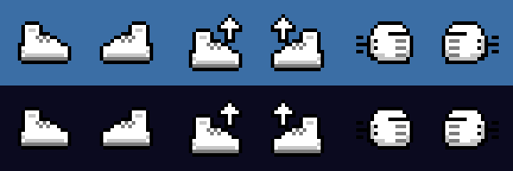
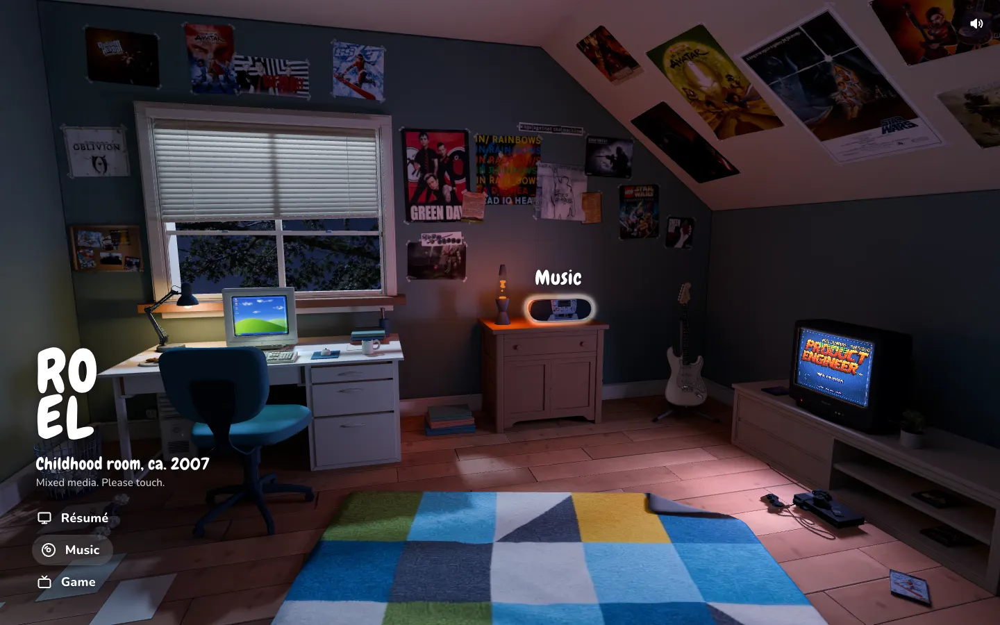
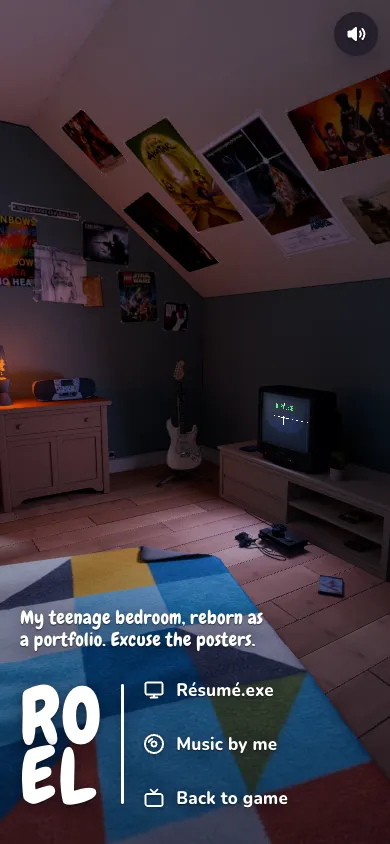
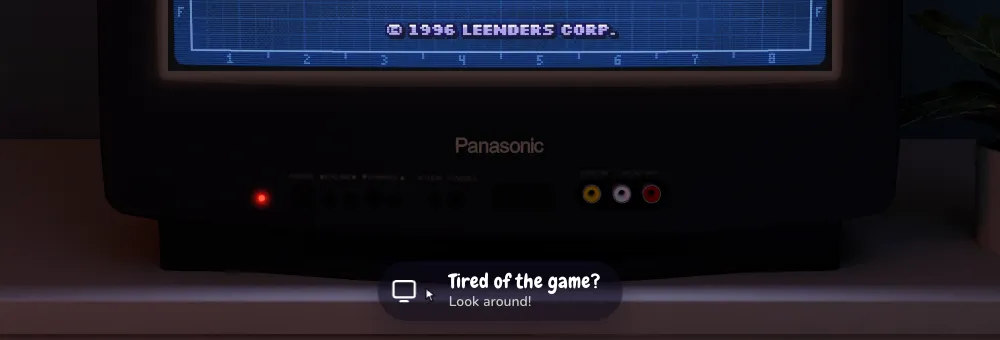

# Art and motion direction

The target is a mid-90s Neo Geo arcade cabinet game (Metal Slug, King of Fighters) shown on a late-90s CRT, with modern restraint in timing.
It should feel authentic first and polished second: chunky hand-placed pixels, limited palettes, banded gradients, ordered dithering, hard flashes and snappy eases — never blurry upscales, soft drop shadows or web-UI rounded corners.

## Global rules

- Native resolution **320 × 240**. One art pixel is one native pixel. No sub-pixel drawing, no rotation of pixel art except deliberate 90° flips, no non-integer scaling of sprites (whole-scene transforms such as the boot logo spin are the exception, and are quantised to whole pixels).
- Palettes are small per element (4–16 colours). Gradients are **banded** (3–6 flat bands), optionally joined by a 2×2 or 4×4 Bayer dither row.
- Text is pixel text: crisp, outlined or shadowed, never anti-aliased.
- Blinking text uses an on/off cycle (e.g. 32 frames on, 16 off), never an opacity fade.
- Motion uses snappy curves: `easeOutExpo` / `easeOutBack` for arrivals, `easeInCubic` for exits, `steps(n)` when emulating sprite-frame animation. Overshoot and settle are welcome; floaty linear tweens are not.
- Every screen has something alive: a twinkle, a bob, a blinking prompt, drifting particles — but at most one focal motion at a time.
- Respect `prefers-reduced-motion`: skip full-screen white flashes and screen shake, shorten camera moves to quick cross-fades.

## The TV (room host)

- Initial framing: straight-on, the TV fills most of the viewport with its full bezel, bottom panel and power button visible and a small margin of the cabinet and wall around it. Where that would leave the game small, the game's picture is as large as the screen allows instead: on a portrait screen it spans the width edge to edge (the bezel cropped at the sides, the set's top and its control panel above and below it), and on a phone on its side it fills the height between the touch pad's controls.
- Power-on: the power LED lights, then the classic CRT turn-on — a bright dot, a horizontal line that snaps open vertically with slight overshoot, a brief brightness bloom and a little vertical roll — about 600 ms, before the boot scene's first frame.
- The screen is a CRT: visible scanlines aligned to the 240 game rows, a subtle aperture-grille mask, slight horizontal softness, edge vignette, gentle bloom on bright pixels, faint glass reflection, and a little halation into the dark tube border beside a bright edge. The picture lights the room as the area light it is: the bezel's inner lip catches it (a blurred band of the picture's edge above and below), and so does whatever faces it (the floor before the set, the nearby walls and the air in front of it, seen from across the room), each in the colours of the part of the picture nearest it and fading with distance, while the flat front of the set and anything behind the screen stay dark. Only the brightest pixels glare, in their own colour: no milky veil over the plastic (docs/ROOM.md › The TV's light).
- When the camera pulls back to the room the game freezes and an on-screen-display style "PAUSE" glyph appears on the CRT.

## The room's UI

The room uses **Velvet dusk**, fixed at **70% haze and 30% dust**: peach lamplight, plum shadows and a dim,
soft summer-night atmosphere. There are no mood controls. Fine dust catches the lamps; the TV and PC pictures stay
sharp and readable. Rain falls outside the window, with rounded refracting beads and slow irregular trails on its glass. Occasional off-screen storm flashes cast cool
light through the blinds across the room, then fade back to the warm lamps. The supplied
attic-rain recording plays quietly throughout room, computer and radio visits, follows the sound toggle, and fades
out at the game. Reduced motion freezes visual rain and dust. The rug retains its plush fibres and folded corner,
with a straight navy-and-white checker pattern and no coloured or diagonal patches. See docs/ROOM.md, Atmosphere.

- **Type.** Headings in Chewy, white; everything else in Nunito 600 (800 for the menu and a track's name), white or 76 % white for the second line. Self-hosted, latin only (`@fontsource/chewy`, `@fontsource/nunito`); `main.tsx` asks for Chewy and Nunito 600 first thing, the rest download the first time something is set in them.
- **Legibility.** No plates: a soft text shadow, and for small type a dark glass pill (`--ui-glass`, fully rounded, a soft lift shadow). The overview sits in a soft corner shade, never an edge.
- **The startup still.** No loading screen: the page opens on a picture of the room's own TV view, the tube lit on a black picture, exactly where the 3D scene will put it (docs/ROOM.md › Startup). The game turns on and plays boot and title on it while the room downloads behind; the visitor's first press (or the game leaving its title) fades it into the identical live scene in 400 ms (at once under reduced motion). Nothing moves but the picture on the tube.
- **The overview** (room view; the captain's own design). Its parts keep to the corners on one strict grid, so the room keeps the middle, and nothing sits on a plate: white type lifted by its text shadow. One margin all round (`--ui-edge`, the sound toggle's too, or the safe area); a top row and a bottom row, each the toggle's height at that margin. The top row's name, menu and toggle share one centre line, and so do the bottom row's line and marks, measured on the type's ink (small em nudges in `RoomGuide.css`). The name's and the line's ink start on the left margin (Chewy's side bearing taken back), and the envelope's centre stands under the toggle's (`e2e/room.spec.ts` measures it). Top left, on the sound toggle's centre line: the name stacked RO over EL, small, in Chewy, and beside it the menu, text only in Nunito 700 at 76 % white: About (the computer), Music (the radio, only while it works) and Game (the TV); screen readers hear "About me (CV)", "Music by me" and "Play game". Bottom left, "A glimpse into my past" in Chewy; bottom right, the quick links to X, LinkedIn and GitHub (the networks' own Simple Icons marks, a new tab each) and an envelope that writes Roel an email (`mailto:`, `guide/Socials.tsx`). On an upright phone the name stays top left beside the toggle, the menu stands large and stacked in Chewy in the middle of the room (60 px tall targets that sink and dim under a finger), the links are centred along the bottom above the home indicator, and the line gives way. It arrives as the camera lands, its corners coming in from their own edges a beat apart (the name and each item drop in, the line and the links rise); it fades out in 180 ms as the camera leaves. It is in the page, hidden, from the moment the guide loads, its marks fetched, so the first arrival is like every later one. On a phone, tilting it looks gently round the room (`guide/tilt.ts`, the pointer's parallax), only where the browser hands over the sensor without asking: the site never asks for motion access, so where it would need permission (iOS Safari) there is no tilt at all; never under reduced motion.
- **Spotlight** (mice and keyboards only: on a touch screen the props neither glow nor wear their names, and there is no tour). Pointing at or focusing a menu item lights its prop, and pointing at a prop lights its item: the prop glows warm white outside its outline, plays a 520 ms squash-and-stretch about its foot, brightens a little, and its item's name pops up over it in Chewy (380 ms, back-out, from 0.6); the item turns full white and a short underline grows under it (docs/ROOM.md › The spotlight). That is CSS on hover and focus too, so the menu answers before (or without) the room's spotlight. The pointer wins wherever it is: a prop under it lights before anything the menu asks for, and over the menu the item under it comes before the one the keyboard has — as it leaves, the keyboard's item lights its prop again. On the first look around, ever, the props light one by one with their items, cut short by a tap, a key, the wheel or the mouse moving on from where it rests — not by the place the browser re-sends for a pointer the view changed under.
- **The TV's way out.** The way back's pill (below) without its key: a line arrow and, in Chewy, "Explore the room" until the visitor has been in the room on this visit, "Back to the room" from then on. It appears the moment the visitor's first press (a key, a click or a tap anywhere) begins the game, or as soon as the game is past its title, and from then on whenever the camera rests on the TV, menus included; after a visit to the room it rises a beat after the camera lands, as the other ways back do. Clicking it flies to the room, as a click beside the TV does; Escape stays the game's here, so it has no key and no keycap. With a mouse it stands along the bottom under the TV like the other ways back. On a touch screen it stands exactly where the radio's own "Back to the room" does (docs/RADIO.md › Controls): in the sound toggle's row at the top left, exactly its height (44 px), or, on a phone on its side under 480 px tall, the round key at the top of the right rail. There a tap above the set leaves too, in any state of the game, and a tap beside and below the set, or on the pad, does nothing; on the title ("PRESS TO BEGIN") a tap anywhere on the set or below its top (its bezel and bottom panel, the cabinet under it, the room beside it) begins as one on the picture does, while one above the set still leaves. It is always a button for the keyboard, first after the stage in tab order and shown on focus (the plain button is in the first load, the pill comes with the guide).
- **The way back.** At the computer and the radio, a pill along the bottom: a line arrow, "Back to the room" in Chewy and, for mice and keyboards, an outlined "Esc" key; it rises a beat after the camera lands, its arrow nudges left under the pointer, and it is a real button after the screen's or the radio's controls in tab order. Mice and keyboards only: on a touch screen the radio has its own "Back to the room" pill in the sound toggle's row (docs/RADIO.md › Controls), and the computer's reader its red close button.
- **The sound toggle.** A white line speaker on a round glass button, named for what it does next: "Unmute me" while muted, "Mute me" while the sound is on. With a mouse the words stand beside the speaker in Chewy, the button a pill the round one's height with the speaker keeping its place in the corner; a touch screen shows the speaker alone (the words are its name for screen readers); its waves ripple back in when the sound comes on, a cross pops in with a turn when it goes off. Pressed, it squashes and springs back with a bounce, and its speaker wobbles like jelly as it changes (`motion/jelly.ts`, shared with the radio's play key). A first visit starts with the sound off; turning it on is a gesture of its own that starts everything at once, and on iOS claims the playback audio session so the ringer switch does not silence the page (`audio/playbackSession.ts`).
- **Cursors** (mice only; `app/cursors/`). Hidden from the first paint until the mouse first moves. Then a chunky, soft-cornered white arrow with a dark outline everywhere outside the screens, a pointing hand in the same hand over anything clickable (the props in the room view, the UI's buttons), the arrow with a little "back" badge wherever a click leaves for the room (beside the TV, the computer or the radio), and over the game's picture the classic pixel pointing hand after the captain's reference (a white glove with a crisp black outline, light-grey shading on its lower and inner edges, grey knuckle dots, the index finger pointing up and to the left; `game/ui/cursor.ts`), its pixels scaled whole (2× and 4×, so 32 × 30 CSS px), the hotspot on the fingertip. Over a level's play the game's own play cursors take over (`game/ui/playCursors.ts`), drawn in the glove's hand, palette and pixel scale and facing the side of the hero the pointer is on: a white high-top sneaker (grey lining and laces, a light-grey midsole and a grey outsole, 32 × 24) wherever a double click walks to, its hotspot at the middle of its sole; the same sneaker with a chunky arrow up over its toe (32 × 32) where the way there takes a jump (a girder, the cable car or U-Bahn, a "?" block, the floor past a pit), the hotspot again under its sole; and the glove made a fist with three speed lines behind it (32 × 24) everywhere else in the play, where a click attacks that way, the hotspot on its knuckles. Over the strip of control hints, in a card or the pause menu and in every other scene, the hand. The computer's screen keeps its own arrow; touch screens draw none.

| The play cursors at 4× (the 2× files): walk, jump and attack, each facing right and mirrored for the left |
| --- |
|  |
- **Focus.** A 2 px white ring, offset; forced colours get system colours and an outline round every pill.
- **Motion.** Arrivals overshoot a little (`--ui-spring`), exits are quick fades; nothing loops for long. Under reduced motion nothing fades, travels, bounces or loops: things appear and go.

| The overview (an earlier layout), its Music item pointed at: the radio glows, holds its jelly and wears its name | On a phone held upright |
| --- | --- |
|  |  |

| The TV's way out under the TV on a first visit, and the sound toggle's words |
| --- |
|  |

## Boot — "ROEL" (homage to the Neo Geo MVS boot)

Reference timing at 60 fps (t in seconds from the first boot frame):

| t (s)       | What happens |
| ----------- | ------------ |
| 0.00        | Screen is white. |
| 0.00 – 0.55 | "ROEL" logo in black, **mirrored**, spins in around the vertical axis while zooming from small to full size (width grows from a sliver; the narrow phases look tall and condensed). |
| 0.55 – 0.80 | Mirrored logo holds at full size on white. |
| 0.80 – 1.35 | Background fades white → mid grey in 6–8 flat steps; the logo flips around the horizontal axis: its height squashes to a 1 px line while it greys. |
| 1.35 – 1.90 | Logo unflips, now readable and white, height growing back; background steps from grey to black. |
| 1.95 – 3.15 | Two lines of condensed bold sans type out under the logo, one character every 4 frames: "LEENDERS" then "PRODUCTION". A soft tick per character. |
| 4.00 – 4.40 | "RCL" fades in from near-black navy to bright royal blue (`#1f6fff`-ish) in 5 steps. Heavy, wide, italic lettering like the SNK mark. |
| 4.40 – 6.40 | Hold. Boot jingle resolves. Any button skips from here (and from 1.0 s on revisits). |
| 6.40        | Cut to black, then title. |

The logo is a high-contrast wide serif set tight, so the serifs almost touch: 144 × 34 px at rest, centred.

## Title — "PRODUCT ENGINEER" (homage to the Metal Slug title)

The title is a lockup on a backdrop that can be swapped independently (docs/ARCHITECTURE.md › Title variants); visitors see the classic lockup on the blueprint backdrop. What follows first is the Metal Slug homage, the classic lockup on the `classic` backdrop: the khaki card, the fireball and the crater are the classic backdrop; the lettering, the name row and the trademark are the classic lockup; the timing, the flash, the prompt and the copyright belong to the scene and hold for every pair.

- Background: warm khaki-olive vertical gradient, dark umber at the top (`#3f3424`) to pale khaki at the bottom (`#b3ab90`), overlaid with horizontal streak noise (rows randomly ±1–2 shades), like an old printed card.
- 0.00 – 0.30 s: a blinding white-core fireball (white → yellow → orange → red rim) collapses to nothing.
- 0.30 s: an impact crater appears centre-screen: a glowing orange-red molten core inside a grey metallic splash crown with long diagonal streaks, wobbling slightly.
- 0.90 – 1.20 s: "PRODUCT" slides in from the right and "ENGINEER" from the left, decelerating hard; they lock together with a 2-frame screen shake.
- 1.25 – 1.45 s: full-screen white flash (skipped under reduced motion), then the settled title. The crater stays partially visible behind the logo.
- Logo lettering: huge, heavy, slightly italic, irregular chunky letters. Face is banded orange (yellow-orange top highlight → orange → red-orange), with a rough rust/stone texture of darker streaks, a deep dark-red extrusion towards bottom-left and a near-black 1 px outline. Small "TM" to the lower right.
- A row above the logo in a condensed cream face (`#efe3b5`) with a dark outline and shadow, the way "SUPER VEHICLE-001" sits over METAL SLUG: "ROEL LEENDERS · PORTFOLIO", the name and the site joined by a middle dot as evenly spaced as the words, ending flush with the logo's rightmost ink. Its glyph cells end six rows above PRODUCT's cap line, so paper shows between its shadow and the letters in every column. It rides in with "PRODUCT".
- The settled lockup is centred on its ink (outlines, shadows and extrusion included) to the pixel; an odd width leaves the spare pixel on the right. "ENGINEER" starts 12 px left of "PRODUCT", so the slanted lines stagger.
- "PRESS ANY BUTTON" ("PRESS TO BEGIN" on a touch screen) below the logo in the chunky arcade face: white → pale lavender banded gradient, dark navy outline and shadow. Blinks.
- "© 1996 LEENDERS CORP." near the bottom in the same face, smaller, appearing after the flash.
- No level or credit counters.

Three more lockups take Metal Slug's own arrangement: the P is raised the way the "M" towers over "ETAL", and the name rides the shelf it leaves above "RODUCT", as "SUPER VEHICLE-001" does.

- The raised P is the logo's own letter, its skeleton scaled before it is rasterised, so it carries the same wobble, chips, cracks, extrusion, outline and glint as its neighbours, with the paint banded over its own height.
- The name ends on the T's top-right corner, starts two pixels clear of the P's outline, and its drop shadow stops one row above the letters below. The P's top is level with the name's outline, as the M is with its kicker.
- The name is set in the "SUPER VEHICLE-001" face, hand-drawn: a condensed grotesque, cream (`#efe3b5`), each upright stroke shaded tan (`#8a7656`) on the side facing into its letter, inside a dark outline and a darker drop shadow. Bars are as thick as stems, corners round off in steps, apertures are tight, the I has slab serifs and the R a straight leg.
- Thirteen characters over six letters, where the reference sets seventeen over four, leave the face at its own size a third short of the shelf; each lockup closes that gap its own way:
  - `faithful`: the face at its on-screen size, 17 px caps, beside a P scaled ×1.5 every way like the M; the name is tracked out evenly to land on the T.
  - `headliner`: the name as the hero, the face redrawn at 25 px caps to fill the shelf at its own tight spacing; the P rises as far as that needs (×1.7) and widens less (×1.45).
  - `heavy-metal`: a bold cut, 22 px caps with 5 px stems around 3 px counters, stamped like plate (banded cream, a lit top edge, a darker foot), beside the broadest P (×1.65 across, ×1.62 up).
- Each line is centred on screen, so ENGINEER sits indented under the wider PRODUCT, as SLUG does under METAL.

### Blueprint backdrop (`blueprint`)

The product, drafted: the title card is the engineering drawing of what the engineer builds. The fireball becomes a plotter-pen strike, the crater becomes measured construction geometry, and the orange logo sits on its complementary blue. The select screens are printed on the same paper, so the title flows into them.

- Palette: one 17-step ramp from unexposed navy (`#050f28`) through Prussian (`#0a1f4a`), cobalt (`#113572`) and blueprint blue (`#1f53a0`) up to the line inks: mid cyan (`#7fb2e8`), pale (`#b0d4f4`), near-white (`#d8eeff`) and the white-hot pen tip. Everything is drawn as a step of it, so the light table switching on, ink cooling and erasing are palette steps, never alpha.
- Sheet: banded paper with Bayer-dithered band edges and sparse grain, darker towards the top corners and lifted by a broad light-table glow behind the logo, so the logo's near-black outline and dark-red extrusion keep about 3:1 against it. Grid lines one step above the paper every 8 px, two steps every 32 px. A drafting frame with zone references 1–8 and A–F in the margin, in 3 × 5 drafting lettering.
- 0.00 – 0.30 s: the strike. A white-hot plot point with a thick cross flare that retracts into it; nine compass rings snap outwards every two frames, fast then slowing, each cooling a ramp step every two frames. The light table switches on behind the newest ring, its grid glowing at the leading edge, so the drawing boots outwards from the impact.
- 0.30 – 0.90 s: measuring. A registration mark lands (9 → 6 px); dimension arrows shoot from the strike to the frame one after another, overshoot a pixel or two and settle, their numbers ticking up to 152, 152, 92 and 132; dashed construction boxes blink in over the lockup's two lines, from its settled bounds, and hold still for the last third of a second.
- 0.90 – 1.20 s: nothing moves but the words; a dash-dot datum line marks the row they meet on.
- 1.20 – 1.45 s: the lock satisfies the construction, which flares white for the two shake frames and is gone under the flash; a 1 px ripple runs out through the grid from the middle of the lockup and is still spreading when the white clears.
- Settled (25 s): a pen plotter drafts one wireframe at a time in the corners beside the prompt and copyright: a phone dimensioned 375, IDEA → ? → SHIP with its NO loop, an eight-tooth gear marked Ø31, and a hockey stick. A small ring echoes the strike as the pen touches down, fresh ink cools behind its crosshair, whose shadow drops as it lifts between strokes. Each drawing holds, then steps back into the paper; each finishes between two glints of the logo, and once a loop the light table's scan line passes down the sheet. The loop starts and ends on a clean sheet.
- Reduced motion: no flare or rings (the light table warms up in four steps behind a still plot point), the arms draw together without overshoot, the boxes never blink, the measurements step down at the lock, the ripple is slow and faint, and there is no scan line.

### Liftoff backdrop (`liftoff`)

Launch night: the product ships at dusk from a pad between Berlin and San Francisco. The fireball becomes the ignition, the crater the smoke billowing off the pad, and the idle loop the exhaust plume drifting over the logo.

- Sky: banded and dithered, from deep indigo (`#0c0922`) through twilight's purple light (`#583486`) to a rose and peach glow (`#e89a70`) on the horizon. The purple sits right behind the logo, a mid tone its dark-red extrusion and near-black outline read against; the warm bands stay below the logo and the prompt. High cloud streaks lit pink from below, and stars at three depths that twinkle in palette steps and drift west, the nearer the faster.
- Skyline: one horizon for both missions in near-black plum silhouettes with a lit rim: Berlin's roofs, the Dom, a crane and the Fernsehturm; the Marin hills, the Golden Gate (with a trace of its red) and a hint of the Transamerica Pyramid. Red aviation lights blink slowly.
- Smoke: round sprite puffs in lavender-greys, ember-lit from below by the exhaust and backlit by the horizon once it has gone, drawn as halos and then bodies so only each mass's outline catches the light. The banks roll by palette cycling.
- Nothing static stands behind "PRESS ANY BUTTON" or the copyright; only the plume's soft column passes behind the prompt, dusky there in the Earth's shadow.
- Reduced motion keeps the composition: the ignition only warms the sky, with no white bloom, flare, rumble or sonic boom, and the twinkle, drift and rolling run at half pace.

| t (s)       | What happens |
| ----------- | ------------ |
| 0.00        | Ignition: the rocket and its tower stand black against a white bloom, a flare streaks the horizon, light floods the sky from the pad in a stepped dome and fire shoots out of the flame trench. |
| 0.00 – 0.30 | The light burns down in steps; smoke erupts from the trench. |
| 0.30 – 0.90 | The smoke rolls out along the ground and up around the pad, glowing like embers; the pad rumbles a pixel and the rocket creeps up out of the cloud. |
| 0.90 – 1.20 | It accelerates up behind the incoming words, its flame stretching into a streak, leaving the plume. |
| 1.20 – 1.25 | It clears the top of the screen as the words lock and the flash hits. |
| 1.45 – 1.95 | A distant sonic-boom ring races across the top of the sky, gone before the first glint. |
| settled     | The plume widens and shears into a lazy S, sunlit above the Earth's shadow; the smoke banks roll. At 5.6 s and 15.6 s, between glints, a little rocket goes up far away, from Berlin and then San Francisco: continuous delivery. |

### Backdrop: Up and to the right (`growth`)

Every product engineer's dream chart on a 1996 phosphor metrics terminal: a hockey stick that breaks through the top of its own chart as the words lock.

- Palette: teal-navy glass from `#01070c` in the corners to a `#276076` haze behind the logo, grid lines a level or two up the same ramp, phosphor-green data ink (`#5cff8a` with a `#c8ffd8` core, white-hot while freshly drawn) and a cyan secondary series (`#3bc3cf`). Nothing warm, so the orange logo is the one hot thing on screen. The haze climbs to a mid value across the logo's band so its dark-red extrusion and near-black outline still read; every other row sits a level lower, a raster texture that lines up with the CRT's scanlines.
- Layout: the chart wraps the classic lockup. Its flat start runs between the logo and the prompt, its blade climbs past the logo's right edge, and it breaks the ceiling at the top right, so the whole hockey stick stays in view. Bars stand between the prompt and the copyright and a ticker runs under the copyright; nothing moves in the prompt and copyright rows.
- Beat sheet, in frames at 60 fps:

| Frames (s)          | What happens |
| ------------------- | ------------ |
| 0 (0.00)            | Impact frame: the whole tube overdrives for one frame, and a spike of light hits the impact point (white core, flat rings of green glow, stepped rays). |
| 1–17 (0.02–0.28)    | The spike retracts in steps while the raster opens from its horizontal ray with a hot leading edge and the grid strips flicker on, outward from the impact row; from frame 12 the beam spot flies to the y axis, leading the eye to where the line starts. |
| 18–51 (0.30–0.85)   | The line draws itself, easing into the trough of sorrow, the last three frames' worth cooling from white-hot to rest. Bars spring up with an overshoot as the head passes them; the scale counts up to 100 %. |
| 52–53 (0.87–0.88)   | The head holds at the turn while the last bars surge: the anticipation pose. |
| 54–71 (0.90–1.18)   | While the words slide, the head rockets up the blade, accelerating as they decelerate. |
| 72 (1.20)           | As the words lock the head breaks the ceiling, tears it open and overshoots before settling just above; a smaller spike lights the breach; data-point confetti (squares, plus signs, triangles, splinters of the ceiling and dimmer, slower specks behind for depth) skids out over the logo; the tube overloads. |
| 87–95 (1.45–1.58)   | After the flash the overload cools a level every three frames into the settled screen, while the confetti flutters down and cools out. |
| From 87 (settled)   | The 25 s idle loop: the head blinks as a cursor in step with the prompt; the tape scrolls at 30 px/s, exactly one tape per loop; the bars ripple to new values halfway between the logo's glints; twice a loop the live bar tops its record and "▲ NEW HIGH" pops beside the cursor. |

- Reduced motion: no impact frame, rays, flare or overload; the glass brightens in steps, the grid lights without stuttering, the rocket eases instead of accelerating, a few pieces drift down without spinning, the cursor and the live dot hold steady and the tape scrolls at half speed.
- Wit: the curve is the startup curve (wiggles of false hope, the trough of sorrow, then the hockey stick), the line goes through the 100 % ceiling, the readout says "LEENDERS CORP · Q4 1996" like the copyright, and the ticker quotes the CV's real metrics straight from the content, with what went down (churn, unhappy customers) in cool cyan.

## Characters

The heroes and the Unhappy Customer are Terraria players (docs/LOOKS.md › The Terraria look): 30 px tall at native size, every frame composed from one shared set of hand-placed parts and posed a drawing per limb, as Terraria poses its player. The heroes wear the look's revision (swept hair that moves a frame behind the body, flat glasses); the customer is the man on the phone. The skills keep the classic look's icons and effects.

- A prop exists only while it is used: the ENGINEER's keyboard, the DESIGNER's Stratocaster and potion, the STRATEGIST's star.
- Attacks and skills work on the move the Terraria way: running, jumping or falling, the legs keep the move while the arms swing the item, so a prop shows whenever the hero uses it.
- Whatever the game draws around a character lands on the art: complaint bubbles leave from the customer's mouth, shots from the hero's hand, the frustration meter over the head, at the escalated customer's 2× too.

## Character select

The menus' pointing hand (character select, mission briefing, stage clear) is the same glove as the pointer over the game, flipped to point up and to the right towards the item, at the game's own pixel scale. It shows where the keys are: it is drawn while the visitor drives the game with the keyboard, a gamepad or the touch pad's buttons, and put away from the moment the pointer moves or presses on the picture (a finger on it included), back with the next key (`InputSnapshot.pointing`).

Layout follows a classic RPG select (portrait card left, details right) but rendered as Neo Geo pixel UI:

- Background: the blueprint title's paper, pixel for pixel and lit the same, with faint diagonal pinstripes every 6 px printed a ramp step above it, as the title prints its fine grid.
- Left: a tall card set into the paper in the blueprint's own ramp. A bevelled pixel frame in its line inks (near-white rim lit from the top-left, mid-blue band, dark inner rim) holds a deep cyanotype field, the ramp's three deepest steps from unexposed navy at the top to Prussian at the foot, banded and dithered as the paper is and darker than the paper around it. In it: stars that twinkle up through the line inks, a spotlight beam whose bands climb a ramp step at a time, a faint class emblem in the beam, drifting class-themed particles (green code glyphs, paint flecks, sticky notes), and the character idling on a blue stone pedestal whose ring and floor glow pulse in the class colour. Chunky triangular arrows in the frame's white and blue either side bob towards the edge and flash on press; switching characters slides the card content with a quick horizontal wipe.
- Right, top to bottom: a small lilac "PICK YOUR ROEL" call to action in the label face whose underscore cursor blinks slowly; the class name ("ENGINEER", "DESIGNER", "STRATEGIST") in the large arcade face, banded from a light tint of the class colour (green, pink, yellow) down to the colour itself, with the prompts' navy outline and shadow; the bio in the small face; a gold "SKILLS" header over two skills, each a 16 × 16 icon in a bevelled steel slot plus its name in white. The skills are shown, not chosen: they have no description and no tooltip, and they react to nothing (no hover, focus, tap or key stop).
- A blinking hand cursor points at the class heading, which stands for the character on show.
- One control legend runs along the bottom in lavender keys and steel labels: "◀▶ CHANGE" under the card, "⏎ CONFIRM ⌫ BACK" flush with the details column's right edge. The drawn keys are 7–8 px tall and centred on the label capitals. CONFIRM and BACK are buttons: pointing lights them, pressing sinks the key one pixel and releasing on it clicks; holding the real key sinks its picture too. BACK returns to the title.
- Confirming plays the character's victory pose, a white flash on the card and a "READY!" stamp before transitioning.

## Mission select

A tongue-in-cheek mission briefing screen: missions are employers, the location is the stage.

- Background: a tactical map on the same blueprint paper as the title and the character select, its faint survey grid every 16 px a ramp step above the paper.
- Each mission is a postcard-like window previewing its parallax stage (live, slowly panning), stamped with its company number ("COMPANY 1"), company, city and years.
- The selected mission shows a briefing panel: role, company context, the briefing copy across the panel's full width and a green "TARGET" with the mission's objective ("FIND PRODUCT-MARKET FIT").
- A locked third slot reads "COMPANY 3 — YOUR TEAM?" with a "contact" call to action instead of a stage.
- The character select's "⏎ CONFIRM ⌫ BACK" keys sit under the briefing panel, flush with its right edge: CONFIRM deploys (or gets in touch from the locked slot), BACK returns to the character select.
- A plane or route line animates between the cities in chronological order.
- Every mark the mission select draws itself is in the blueprint's cyanotype inks (`src/game/scenes/title/backdrops/blueprint/inks.ts`), as the character select's card is. The COMPANY tabs and the cleared star tallies are folder tabs a few ramp steps under the paper with a lit top edge; the locked slot's "classified" hatch marches in paper blues; the route's unreached stops and its dotted leg to the visitor's team are the pale and mid line inks, and the plane's contrail fades from white into the paper. The header's MISSION SELECT and the "?" marks band the arcade face from white down the line inks, outlined in the paper's darkest navy; the "1P" tag, the briefing's company context and the teaser's STATUS line are mid-blue; the teaser's CONTACT key is lit like the character select's focused skill slot (`LIT_WINDOW`). Gold (tab numbers, flown legs, the focus frame), green (TARGET), white copy and red stamps keep their meanings on top. The ⏎ CONFIRM ⌫ BACK legend and the hand cursor are the character select's and stay lavender with it. Secondary lettering stays at least as legible as the lavender it replaced: the company context is 5.2:1 on the panel's lightest band (was 4.8:1), the tabs' gold numbers 10.4:1, and CONTACT's gold at least 5.2:1 on its key while focused brightens it (was 5.1:1). The stage-clear finale draws the same locked postcard in its night sky's indigo, the scheme of the rest of that screen.

## Levels

Short (60–90 s), forgiving side-scrollers in the spirit of Metal Slug and Super Mario.

- Four or more parallax layers per stage, generated as painted pixel art and quantised to small palettes: sky, far landmark skyline, mid city, near props, plus an optional sparse foreground layer that passes in front of the player.
- **Luna · San Francisco** — golden-hour fog rolling over the Golden Gate, Painted Ladies on steep streets, cable-car tracks, the Transamerica Pyramid. Warm oranges and cool fog blues.
- **Scripe · Berlin** — night, Fernsehturm on the horizon, Altbau facades with graffiti, the yellow U-Bahn on its viaduct, Späti neon, construction fences. Deep violets, sodium yellows, neon pinks.
- The only enemy is the **Unhappy Customer**: shouts complaint speech-bubbles (the level's complaint lines) that hurt on contact. Attacks lower their frustration; at zero they turn happy (palette swap to calm colours, a heart and a "+MRR" pop) and stroll off. Nobody dies.
- The control hints stay along the bottom for the whole level (from 1.2 s in, after the mission intro): MOVE, JUMP, ATTACK, SKILLS and PAUSE, each with its key caps on a dark strip; the boss bar rises onto the strip rather than over it. With a mouse they are keys (docs/ARCHITECTURE.md › Mouse play): pointing at one lights it, its face white, its side a step lighter, ringed in gold, with its label gold; pressing it sinks it a pixel into its bottom edge for as long as it is held, and holding the real key does the same, so the strip always shows which keys are down. With a gamepad they show its buttons; on a touch screen, until a key is pressed, the touch pad's own controls in its colours: its d-pad, the red A, yellow X, green Y and blue B, and its Start (the HUD's skill keys too). So do the menus' prompts: the select screens' CONFIRM and BACK keys become the pad's red A and blue B, the stage-clear screen's "CONFIRM: CLOSE" and "UP: READ HIGHLIGHTS" its A and d-pad, and the pause menu's resume key its Start (`ui/prompt.ts`). The pad itself carries the same letters on its caps instead of words, so the four buttons read apart without their colours, and its Start, a bare capsule with no word, sits in the middle of the screen a step above the buttons' top row, clear of them and of the d-pad.
- A label a pixel under every customer's feet names them, in every customer look: "Unhappy customer" in the frustration meter's scarlet (`#ff3a4a`) while they are frustrated, "Happy customer" in the +MRR green from the hit that wins them over until they have strolled off. One line of the small body face outlined in ink like the HUD's lettering, 11 px tall with its outline (80 px wide unhappy, 70 happy), so every letter keeps the same contrast against its outline on any street or sky: 5.5:1 scarlet, 10.9:1 green. The switch pops: for 1/20 s from the winning hit the letters flash white and hop up two pixels, for another 1/20 s they sit a pixel up in green, then they rest (three frames each in play); a label popping in under another, or beside one on the row above, hops only as far as that label leaves room, so the pop never brings two labels within 6 px side by side, and reduced motion swaps them in place. Labels are drawn over everything in the street, so a customer on a raised floor wears its label across that floor's front, and over the foreground's occasional posts too, which would otherwise cut words out of a label far more often than out of the narrow customer above it ("Unhapp ustomer"). A label that meets a character (the hero, or a customer, standing lower down; its own customer while it hops, or while a shake holds it up) is drawn behind every character instead, so a sprite always stands in front of a label it meets and no label ever covers the hero's feet. The escalated customer is labelled once it has landed: on the way down, the ESCALATED! banner names it. The screen's edge never cuts a label, since cut at the left "Unhappy customer" would read "happy customer": near an edge it slides inward just far enough to stay whole, still under its customer, and a customer whose middle is off screen goes without. Labels never run into one line or cover each other: where two would come within 6 px side by side, one steps down a row, still centred under its own customer. Labels claim room in order: unhappy customers first, then labels already showing, then the customer nearest the player; a label keeps its row while it fits (so an unhappy label can stay a row under a happy one) and steps back up only with room to spare. Rows stay clear of the HUD along the bottom: while the boss bar's strip (from y 195, on the hints) or the control hints' strip (from y 221, all level long) is up, only the row under the feet fits. A screen shake moves the labels with the street, but never one against another or onto another row: where it would carry a label off the screen or into the HUD (the rows a rising boss bar is about to take included, and those its bounce reaches past its place), all the labels are held back together, just far enough. A label with no room left, a third in the same stretch or a second while one of those strips is up, waits until the crowd parts rather than show half hidden. Labels belong to customers in play: the stage-clear and finale screens' waving customer, an illustration beside the hero, wears none.
- Career highlights are collected from "?" blocks and shown as an achievement banner; the stage-clear screen lists every highlight with metrics.
