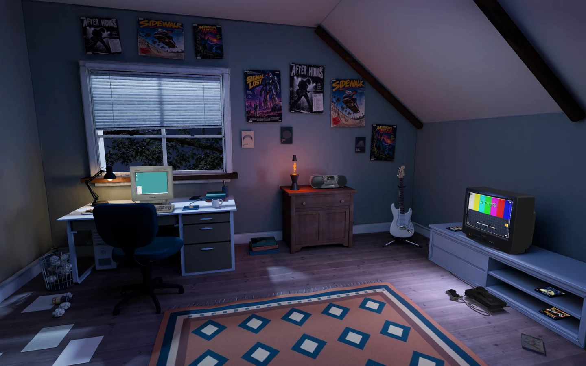
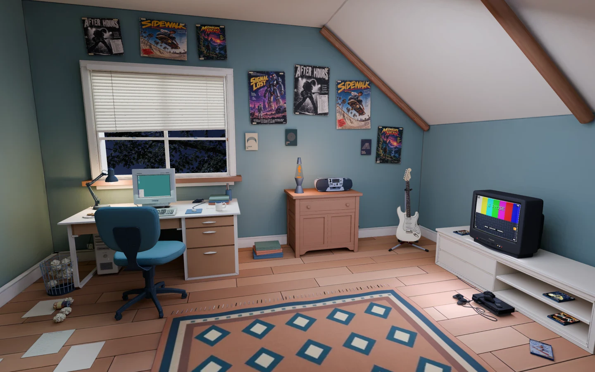
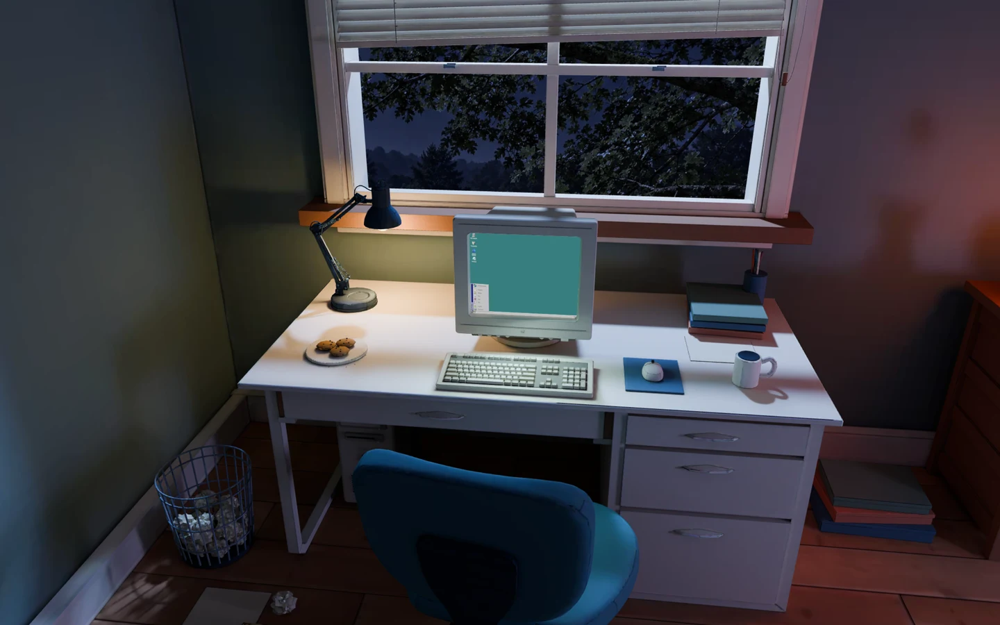

# After hours — room asset revision 6

The room keeps its composition, attic shell, furniture, electronics, guitar and game
cases, with improved finishes, edge treatment and night lighting. The floor pillow,
ceiling beams and wall posters/cards are removed. A supplied folded rug replaces the old rug.

Browser captures from the room lab, with the same camera and test picture:

| Before | After |
| --- | --- |
|  |  |

The desk and radio cabinet are now clickable, with responsive close-ups and eased
transitions back to the room. Keyboard and touch navigation reach the same views.

| Desk close-up | Radio and lava-lamp close-up |
| --- | --- |
|  |  |

## Reference study

Reference: [Bruno Simon's My Room in 3D](https://my-room-in-3d.vercel.app/)
and its [source](https://github.com/brunosimon/my-room-in-3d).
The live scene was inspected at desktop size, alongside `Baked.js`, its fragment shader,
the asset list and the renderer. No reference geometry, artwork or source code is included.

The defining quality is a carefully modelled miniature. Large shapes are simple and
readable, with enough bevels to catch light. Detail is concentrated in silhouettes,
controls, keys, books and personal objects. Broad surfaces are quiet: wood has restrained
grain, fabrics have soft shading, and plastic does not look like polished metal.
It is stylized realism, rather than flat-shaded low poly or heavily weathered realism.

The reference's lighting is particularly important. Its shader blends day, night and
neutral baked textures, with a separate RGB light mask for the desk, PC and TV. Soft
contact shadows, reflected light and warm/cool separation make individually different
objects feel like a single scene. Its renderer does not rely on expensive runtime
shadow maps or a postprocessing stack for that appearance.

| Aspect | Previous room | Revision 6 |
| --- | --- | --- |
| Material language | Worn scans, noisy paint, glossy electronics and flat props | Cream enamel, oak/walnut, muted teal cloth, slate ABS and restrained brushed metal |
| Surface detail | Strong scan grain and small wear marks competing with the silhouettes | Restrained furniture grain, natural floor fibers, quiet paint and readable original labels |
| Geometry | Sharp furniture, a flat photographed floor and faceted chair | Metre-scale edge radii, shallow bevelled floorboards, welded and smoothed upholstery and mouse |
| Lighting consistency | Baked furniture with independently lit PBR devices | One Cycles lighting setup baked across furniture **and all four devices** |
| Night atmosphere | Dark blue shadows with warm pools from the lamps | Original night colors and local practical lights, with much dimmer broad fills and world illumination |
| Contact and depth | Device lighting did not match its baked contact shadow | Device shading, soft contact shadows and surrounding bounce share a light source |
| Texture fidelity | Different texture densities and multiple PBR channels per device | Dedicated 2K TV-front atlas, 1K TV-rear/PC/radio/PS2 atlases, density allocated to visible details |
| Runtime cost | Environment capture and multiple live lights for imported devices | Unlit static assets; one hemisphere for moving lava/glass; existing CRT glow |

## Specific treatments

- **Lighting:** the original nighttime colors and local practical lights are preserved.
  World illumination is reduced to 12% of the original and broad blue fills to about
  10%, keeping the ceiling and corners in deep shadow. Narrow window highlights,
  the desk's tungsten light and the lava lamp's amber glow stand out against that
  darkness. Furniture and electronics share the same bake. AgX contrast and exposure
  remain at the original settings.
- **Room:** the same wall and ceiling geometry gets matte, muted plaster and cream trim.
  Wooden ceiling beams and all wall posters, cards and masking tape are removed.
  The original floor's footprint and top height are preserved while its mesh becomes
  shallow oak boards with small seams and rounded edges. The original wood scan adds
  natural grain and pores while the new floor's warm oak colors remain.
- **Furniture:** the original desk, dresser and TV cabinet retain their proportions and
  placement. Shared cream paint and wood finishes replace unrelated scans and wear.
  All four desk drawer fronts use the desk's white enamel; their original handles remain.
  Six-millimetre furniture bevels and smaller trim bevels make edges catch light.
- **Rug:** the supplied Sousinho rug keeps its original folded mesh and backing. It
  becomes a 2.3514 m square, matching the old rug's width, and rotates 15° clockwise.
  The folded corner remains nearest the TV. A new plush geometric textile follows
  the user's reference palette of teal, aqua, mustard, rust, green, ivory and charcoal.
  The pattern covers the top; the folded underside remains plain woven backing.
- **Chair:** petrol upholstery uses a fine, low-amplitude weave. Welding its UV-split
  vertices before subdivision avoids cracks between imported triangles; its original
  silhouette remains recognizable. The floor pillow is removed from the exported scene.
- **Electronics:** the CRT, PC, radio, PS2 and controllers keep their source models,
  controls, labels and logos. Roughness and normal-map amplitude are restrained, then
  their static surfaces are baked in the room. The TV front has its own 2K atlas for
  the opening close-up; the rear uses 1K. Screens remain separate and replaceable.
- **Game case:** the original SSX3 case and printed insert remain. Its separate
  translucent overwrap is removed for the matte finish, so an opaque lightmap cannot
  obscure the original cover. The remaining case geometry and placement are preserved.
- **Guitar, lamps and clutter:** warm ivory lacquer, restrained metal, muted book colors
  and warm paper sit in the same palette. Original game-cover artwork remains.
  Hidden box-body caps beneath the fitted game-box lids are removed: their coplanar
  surfaces caused black stripes and depth fighting in WebGL.

## Boundaries and tradeoffs

This adopts the reference's material discipline and baked-light approach; it does not
copy its furniture, isometric camera or interactive day/night blending. Roel's layout,
original room/TV viewpoints and arcade behavior remain unchanged. The desk and the
radio/lava-lamp cabinet now have their own clickable close-up views, using the same
camera transition style as the TV.

Static reflections are baked, so they do not move when the camera moves. That is a
deliberate compromise for consistent appearance and economical rendering. Moving a
device or changing the room lights requires a rebake. The existing animated lava and
interactive CRT picture/glow remain live. Source license and attribution notes remain
in `public/room/CREDITS.txt`.

Furniture and window atlases are 2K to keep fine edge highlights readable. Source
normal maps keep their original tangent-space UVs during the bake; atlas gutters
extend each island's own color to limit dark seams when textures are filtered.

| Runtime asset cost | Revision 5 | Revision 6 |
| --- | ---: | ---: |
| Five GLBs and credits | 7.87 MB | 6.65 MB |
| Decoded texture pixels | 47.72 million | 41.69 million |
| Total asset triangles | 245,893 | 328,951 |
| Room-view draw calls | 55 | 57 |

The texture allocation decreases despite the sharper front-facing atlases, because
static devices no longer ship separate normal/roughness maps. More geometry goes to
silhouettes and bevels. The room still idles at zero renders with reduced motion;
visible lava schedules 24 frames per second. These are local Chromium measurements,
not a guarantee of a particular frame rate on every device.

The rebuild recipe, source requirements and verification commands are documented in
[tools/room/README.md](../tools/room/README.md). The generated rug texture, its prompt
and the supplied model's attribution are documented in
[the rug authoring inputs](../tools/room/assets/README.md).
