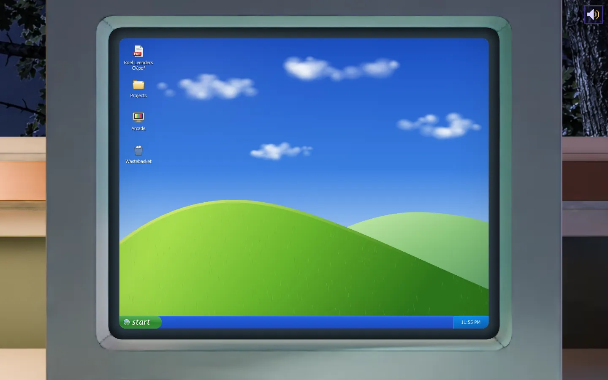
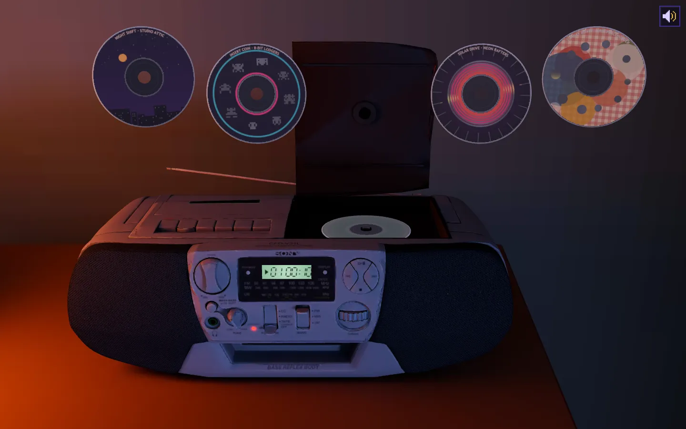

# After hours — the room's look

A teenager's attic bedroom on a rainy summer night, some time around 2007: a desk with a beige computer under the
window, a pine dresser with a CD player and a lava lamp, a guitar on its stand, a CRT television on a white cabinet
with a console on the floor in front of it, a navy and ivory rug, and walls covered in posters.

This document is the visual spec: what the room is made to look like, and why. How it is made is in
[ROOM.md](ROOM.md) › The generated room: every prop is a function in `src/room/gen/props/`, every surface a function
in `src/room/gen/materials.ts`, the light a table in `src/room/gen/rig.ts` that the visitor's GPU bakes once, and the
posters are paintings in `src/room/posters/paint/`. No model, texture or image is shipped. A change to the look is a
change to that code.

The pictures under `docs/room/` (`after.webp`, `pc.webp`, `radio.webp`, `desktop-detail.webp`, `basket.webp`) were
captured from the room with shipped models (§ History). The composition, the palette and the light are what the
generated room was matched to, so they still show the intent; the props in them are not the ones a visitor sees now.
`docs/gen/reference/` holds that room from the fixed cameras `scripts/gen-shots.mjs` uses.

| At the computer | At the CD player |
| --- | --- |
|  |  |

Clicking the computer or its desk seats the camera straight in front of the monitor, where the app's live desktop
takes over from the still on the glass ([PC.md](PC.md); [ROOM.md](ROOM.md) › The computer's monitor). Clicking the
radio, its cabinet or the lava lamp sits the camera over the CD player with its lid open and the collection floating
above it ([RADIO.md](RADIO.md); [ROOM.md](ROOM.md) › The CD player).

## Reference study

Reference: [Bruno Simon's My Room in 3D](https://my-room-in-3d.vercel.app/)
and its [source](https://github.com/brunosimon/my-room-in-3d).
The live scene was inspected at desktop size, alongside `Baked.js`, its fragment shader,
the asset list and the renderer. No reference geometry, artwork or source code is included.

The defining quality is a carefully modelled miniature. Large shapes are simple and
readable, with enough bevels to catch light. Detail is concentrated in silhouettes,
controls, keys, books and personal objects. Broad surfaces are quiet: wood has restrained
grain, fabrics have soft shading, and plastic does not look like polished metal.
It is stylized realism, rather than flat-shaded low poly or heavily weathered realism.

The reference's lighting is particularly important. Its shader blends day, night and
neutral baked textures, with a separate RGB light mask for the desk, PC and TV. Soft
contact shadows, reflected light and warm/cool separation make individually different
objects feel like a single scene. Its renderer does not rely on expensive runtime
shadow maps or a postprocessing stack for that appearance.

What the room takes from it:

| Aspect | The room |
| --- | --- |
| Material language | Cream enamel, oak and stained pine, petrol cloth, slate and beige ABS, restrained metal |
| Surface detail | Restrained grain on furniture and floor, quiet paint, readable labels in plain words; no wear, no scans |
| Geometry | Rounded edges and bevels that catch light, detail kept to silhouettes, controls and keys |
| Lighting consistency | One set of lights for furniture and devices alike, baked once with soft shadows |
| Night atmosphere | Dark, cool corners and ceiling with warm pools at the lamps |
| Contact and depth | Every prop's contact shadow comes from the same lights as its shading |
| Runtime cost | Unlit surfaces that read the bake; only what changes (the TV's picture, the storm, the wax) is live |

## The look, part by part

- **Lighting.** Night. The window's cool light comes under the half-lowered blind as a bright patch past the desk's
  end and, dimmer and unstriped, through its slats; the desk lamp's tungsten and the lava lamp's amber are small warm
  pools; an opal globe beside the TV and a dimmed bare bulb on its other side light the cabinet top so the opening view is not lost
  in the dark. Broad fills are very dim, so the ceiling and the corners stay in deep shadow. A filmic curve is part of
  the bake. The finish on top of it ([ROOM.md](ROOM.md) › Atmosphere) is Velvet dusk: peach lamplight, plum shadows,
  a little haze and dust.
- **Room.** 5.6 m × 4.8 m, 3.28 m high on the left, the ceiling sloping down to a 1.88 m knee wall on the right.
  Painted beadboard walls with a cream skirting, matte plaster ceilings, a door behind the camera. The floor is oak
  boards with small seams and restrained grain. The window has a narrow ivory casing, a deep sill, two sashes and a
  venetian blind let halfway down, its slats nearly shut; rain runs down the glass, and behind it a tree's crown
  stands against the night sky, a few leaves catching the street's light.
- **Furniture.** A white desk under the window (a frame leg at the left, a three-drawer unit at the right), a
  stained pine dresser with a drawer and two panelled doors against the back wall, and the white TV cabinet against
  the knee wall (two drawers, two open shelves, a low plinth). Cream enamel and wood; edges are bevelled so they
  catch the lamps.
- **Rug.** A 2.35 m square of navy and ivory checks with a soft pile, turned 15° clockwise, the corner nearest the
  TV folded back to show its grey backing. Straight checks; no coloured or diagonal patches.
- **Chair.** A swivel chair in petrol cloth on a gas lift and a five-armed base on castors, facing the desk.
- **Desktop.** A beige CRT monitor on a swivel foot, a two-tone full-size keyboard with every key and a wheel mouse
  on a mat; a beige tower with two drive bays under the desk and a jointed arm lamp. The screen is a separate glass
  the app paints ([PC.md](PC.md)).
- **Television.** A slate ABS set: a front frame whose lip slopes in to the glass, a rounded shoulder, a rear shell
  stepping in to the back plate, a plinth, a strip of round buttons under printed legends and front jacks. Its
  wordmark is the site's own. The glass is a separate mesh with the CRT shader.
- **TV cabinet top.** At the set's right an opal globe lamp on a round metal foot and a 21 cm plant in an ivory
  pot, broad dark leaves with a paler midrib; at its left a bare-bulb lamp turned most of the way down (a turned
  walnut base, a brass holder, a clear bulb whose cage filament glows orange, a braided flex with a bakelite rocker
  switch).
- **Console.** On the floor in front of the cabinet: a slim black console of its years, a design of its own with
  the room's wordmark, two pads on their cables, a memory card and a game case beside it.
- **Game cases.** Three, with covers made for this room: Powder Rush, Crown & Key and Brick Galaxy, the games the
  posters advertise.
- **CD player.** A portable radio cassette CD deck of the nineties, drawn for this room: two speaker pods with
  louvred fronts either side of a silver panel (a display lens, a round transport cluster, a tuning dial, a chin of
  switches), a cassette deck and the CD lid on its sloping top, a folded handle and an aerial. It carries no brand:
  its wordmark is the site's and its legends are plain words. Under the lid: a ribbed underside, a well with a dark
  turntable, a pickup and the slot the discs rise from, dark at night so the lamp-lit disc is the bright subject.
  The discs are drawn, not baked: silver foil that reflects the dark room and draws the lava lamp's spoke and
  rainbow across its tracks, matte ink under a varnish glint and a smoky hub, so plain silver discs already read as
  CDs in the night palette rather than as stickers. Their data side, which faces the camera as they rise and go
  home, is a lit silver mirror with a polished rim, never a flat grey. Prints are a CD's, not a record's grooves.
- **Lava lamp.** An hourglass foot and a cone of a cap in anodised aubergine metal, dark enough that the wax is the
  only bright thing about it; the wax rises, necks, merges and parts on slow clocks that never repeat within a
  visit.
- **Guitar.** A cream double-cutaway electric on a tripod stand between the dresser and the TV: a white scratch
  plate with three pickups, a maple neck with a rosewood board.
- **Wastepaper and clutter.** A wire basket by the wall with eighteen crumpled sheets, fifteen inside and three on
  the floor; three books on the desk and three big ones stacked on the floor by the dresser; the radio's mains lead.

## Posters

The walls take the reference room's habit of covering every free surface with what its owner loved. Twenty-nine
printed pieces and a corkboard, all original and fictional, made for this room and painted in code
([ROOM.md](ROOM.md) › Posters lists them): one band, The Loud Hours, across a poster, a tour banner, an album print
and a ticket stub; the three games on the room's own shelf as shop posters and three more that never existed; a
star chart, a patent drawing, a blueprint, a travel print, film sheets, flyers and stickers.

- **Composition:** a focal music corner above the dresser with pieces overlapping; an uneven frieze over the
  window; a store promo left of the window above a corkboard of pinned, overlapping pieces; and on the slope film
  sheets and folded magazine pull-outs up to the ridge. Nothing on the knee wall, nothing near the window casing
  and nothing in the resting TV, PC or radio frames.
- **Physical detail:** every sheet has its own masking tape (cream on the back wall, white paper tape on the pale
  slope) with the small shadow under it; overhangs ramp down from the card to the wall. Paper sits
  1 + 0.75 · n mm off the wall by layer, with a contact shadow (the skirt) multiplied onto the wall around it. The
  pull-outs keep their folds, corners curl away from the light, gloss sheets have a sheen, the cork has grain and
  pins. The night's light is painted into the pieces: a dim mauve fill right of the window, bluer and dimmer left
  of it, the lava lamp's amber pool under the music corner.
- **Designs:** bold shapes and headline type in a handful of colours each, in the site's three faces. At the
  wall's density a millimetre is about half a texel, so small print is there to read as small print.

## Boundaries and tradeoffs

This adopts the reference's material discipline and baked-light approach; it does not
copy its furniture, isometric camera or interactive day/night blending. Roel's layout,
room and TV viewpoints and arcade behavior are the room's own.

The light is baked, so shadows and the lamps' pools do not move; the varnish, the TV's picture on the room and the
storm's flashes are the live exceptions. Moving a prop or changing a lamp is a change to the code and costs nothing
to rebuild, because every visit bakes it. The bake has no indirect light: a pool over the floor and a bounce stand in
for it, placed by eye.

The props are parametric, which suits furniture, cases and moulded plastic and stylises what is organic: the plant's
leaves are folded blades grown from a seed. Nothing in the room is a scan.

Nothing in the room carries a third party's mark, artwork or model: the wordmarks are the site's own, the game
covers and posters are fictional, and the devices are designs of their own in the manner of their years.

## History

The room was first built in Blender ("room asset revision 6"): sourced and hand-made models restyled to the look
above, lit by one Cycles setup, baked into atlases and shipped as five GLB files, with the posters as a baked layer of
third-party artwork that was never published. A pipeline under `tools/room/` built and verified it. Commit `0e275c7`
replaced all of it with the generated room and removed the files and the pipeline; the generated props stand where
those stood and were matched to them in place, size, palette and light, from pictures (`docs/gen/reference/`) and
from measurements kept as numbers in `src/room/gen/roomSpec.ts` and `gen/props/radioSpec.ts`. None of the earlier
meshes, UV layouts or textures is in the repository or in what a visitor downloads.
